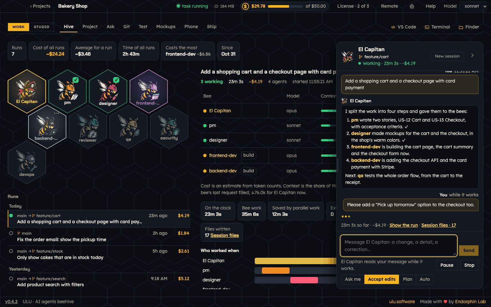
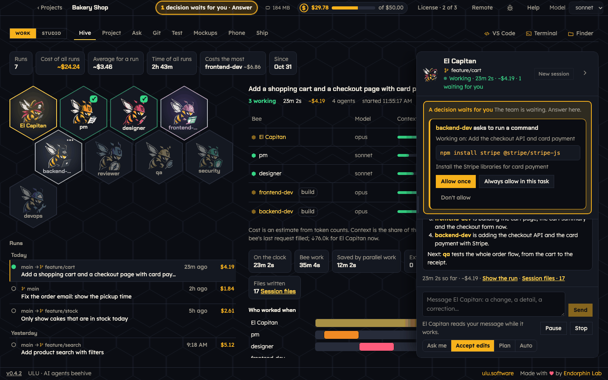
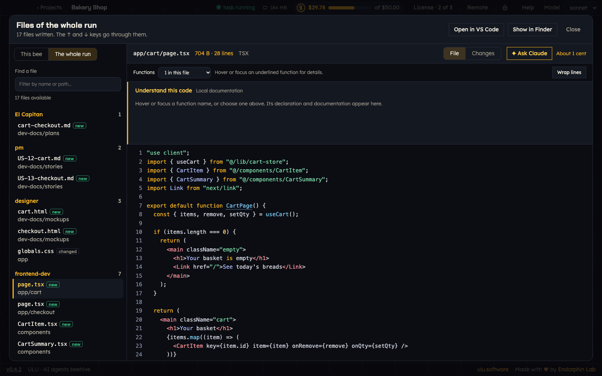
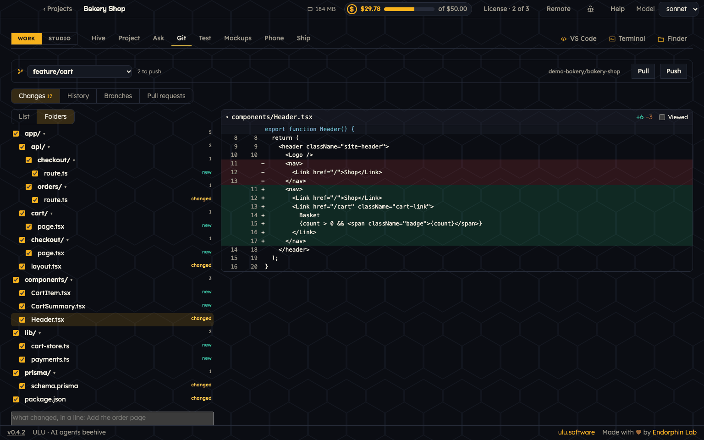
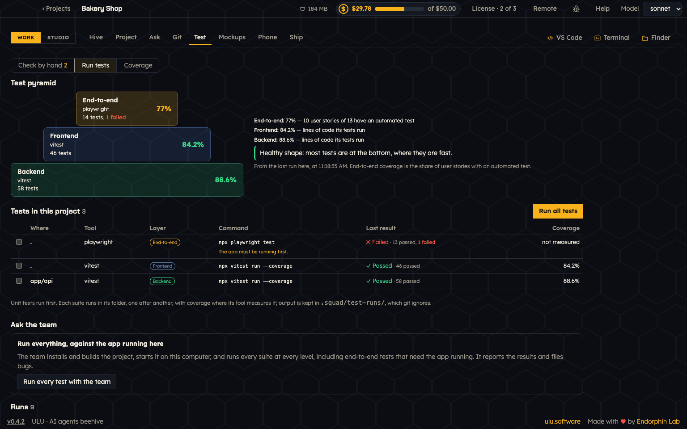

# ULU for macOS

**ULU, the AI agents beehive:** describe your project and get an AI team of Claude Code agents that builds it. You watch every step.



ULU is a desktop app for your Mac. You tell it what you want to build, in your own words. ULU gives you a team of AI agents, called **bees**. Each bee has one job: plan, design, build, review, test, check security or deploy. **El Capitan** leads them. You give the team a task, and you see which bee works, what it writes, how long it takes and what it costs.

ULU runs on top of [Claude Code](https://claude.com/claude-code) on your Mac. Your code stays in your project folder.

This repository holds ULU's downloads, its update feed and its user guide. ULU's code is not here.

## What you can do

- **Get a team in minutes.** Pick one of ten ready teams, or design your own with Kukulu, the builder bee. ULU writes the team into your project. It also works with a project that already has code: it reads your stack, scripts and tests first.
- **Watch the hive.** Every task shows its bees, their model, cost, time, tools and files. Every run keeps its branch, its cost and its whole talk with El Capitan.
- **Talk to El Capitan while the team works.** Write a change or a correction and press Send. No pause needed.
- **Never miss a question.** When the team needs your decision, the question is pinned on top of El Capitan, and the top bar says **1 decision waits for you**.
- **Sessions on branches.** **New session** starts a new talk on a new git branch, or on a branch you already have.
- **See every file a bee wrote.** **Session files** groups them by bee and says if each file is new or changed.
- **Git without the terminal.** Review changes as a list or a folder tree, commit, push, switch branches and handle pull requests.
- **Run all your tests.** The Test tab finds your test suites, runs them, and shows a test pyramid with coverage. Check things by hand and write a bug for the team.
- **Ask about your project.** Questions about your code get answers with links to files, commits and runs.
- **Waits out usage limits.** When your Claude limit is reached, the task pauses and goes on by itself after the reset.
- **Phone, mockups and shipping.** See an Expo app in a phone, view mockups, and deploy to Render with a domain through Cloudflare.
- **Stay on budget.** See what each project costs and set a budget. Get notifications on your Mac, or on your phone with ULU Remote.

<table>
<tr>
<td width="50%"><br><sub>A question from the team, pinned on top.</sub></td>
<td width="50%"><br><sub>Session files: every file of a run, by bee.</sub></td>
</tr>
<tr>
<td width="50%"><br><sub>Git: changes as a folder tree.</sub></td>
<td width="50%"><br><sub>Test: the test pyramid and your suites.</sub></td>
</tr>
</table>

## Install

With Homebrew. This also installs git, the GitHub CLI, Node.js, Claude Code and Ollama:

```sh
brew install --cask endorphin-ai/tap/ulu
```

Or download `ULU-macos-universal.zip` from the [latest release](https://github.com/endorphin-ai/ulu-releases/releases/latest), unzip it and move **ULU** to Applications.

## Requirements

- macOS 12 or later.
- Apple Silicon or Intel.
- ULU is signed and notarized by Apple.
- Claude Code, signed in. ULU uses your Claude plan or API usage.

## First steps

1. Open a terminal and run `claude` once to sign in to Claude Code.
2. Open ULU, press **New project**, and describe what you want to build.
3. Pick one of the ten ready teams, or design your own with Kukulu.
4. Open the **Hive**, tell El Capitan what the team should do, and press **Start**.

Read the full [Getting started](docs/getting-started.md) guide.

## Pricing

One project is free. More projects need a paid key. ULU Remote (the hive on your phone) also needs a paid key.

## Updates

ULU checks this repository for a new version. You see it in **Help → Updates**, or run `brew upgrade --cask ulu`. Every update is signed and checked. ULU keeps the version you have and goes back to it by itself if a new one does not start.

See what changed in the [changelog](CHANGELOG.md).

## User guide

- [Getting started](docs/getting-started.md)
- [Studio: brief, design and build your team](docs/studio.md)
- [The Hive and El Capitan](docs/the-hive-and-el-capitan.md)
- [Files and Git](docs/files-and-git.md)
- [Tests](docs/tests.md)
- [Ask](docs/ask.md)
- [Phone, mockups, shipping and Remote](docs/phone-ship-and-remote.md)
- [Costs and budget](docs/costs-and-budget.md)
- [FAQ and troubleshooting](docs/faq.md)
- [Reporting a bug](docs/reporting-bugs.md)

## Report a bug or ask for a feature

Something does not work? [Open an issue](https://github.com/endorphin-ai/ulu-releases/issues/new/choose). Please read [Reporting a bug](docs/reporting-bugs.md) first. Never paste keys, tokens or private code in an issue: issues are public.

## Links

- Website: [ulu.software](https://ulu.software)
- Downloads: [latest release](https://github.com/endorphin-ai/ulu-releases/releases/latest)

Made by [Endorphin Lab](https://endorphinailab.com/).
