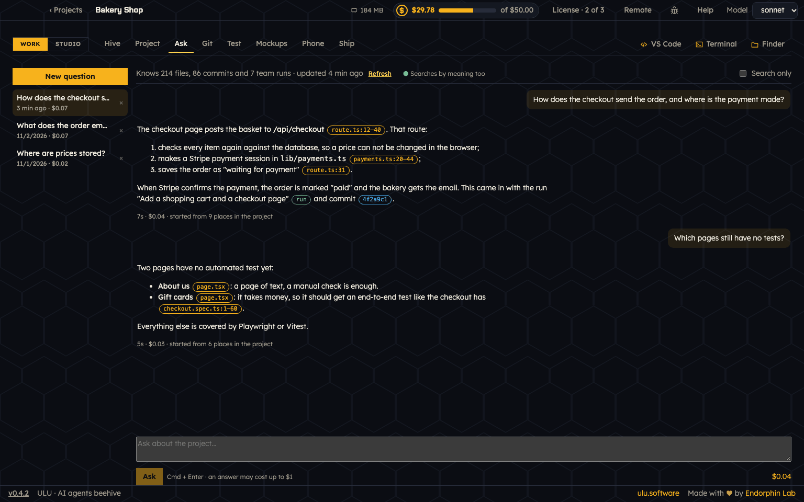

# Ask

Open **Work → Ask** to ask questions about your project, in plain words.

## Ask a question

1. Press **New question**, or write in the box at the bottom.
2. Ask what you want to know. For example: "How does the checkout send the order?" or "Which pages still have no tests?"
3. Press **Ask**, or Cmd + Enter.

ULU finds the places in the project that fit your question, and Claude answers from them. The answer has small links:

- a **file** link opens the file at the right line,
- a **commit** link opens the commit with its changes,
- a **run** link opens the run of the team.

**Back to Ask** brings you back to your chat. Earlier chats stay in the list on the left, with their cost.

On top, Ask says what it knows: how many files, commits and team runs, and when it last read the project. **Refresh** reads the project again.

## Search only

Tick **Search only** to see the places in the project that match, without asking Claude. It is free.

## Search by meaning

Meaning search finds code that means what you ask, even when it uses other words. A small model makes it on your Mac with **Ollama**. Nothing leaves the Mac, and it costs nothing.

- When it is on, Ask shows **Searches by meaning too**.
- If Ollama is missing, Ask offers to install it.
- If the model is missing, Ask offers to download it (about 270 MB).

Homebrew installs Ollama with ULU. You can also install it from **Set up this computer**.

## What it costs

An answer uses Claude. Ask shows the cost of each answer and of each chat. An answer may cost up to $1.
