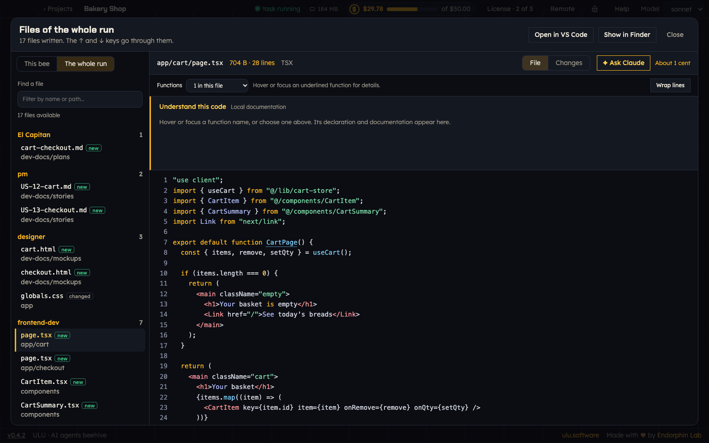
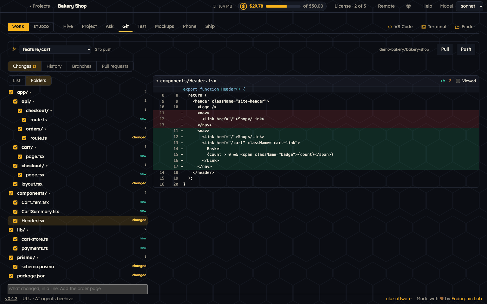

# Files and Git

## Session files

**Session files** opens every file the bees wrote in a run, in one window. You find the button in El Capitan's talk, and under **Files written** in the run. The number on it counts up while the team works.

- Files are grouped by bee. **The whole run** shows all of them, **This bee** only the files of the bee you chose.
- Each file says **new** when the bee made it, or **changed** when the bee changed a file that was already there.
- **Find a file** filters the list. The ↑ and ↓ keys go through the files.
- **File** shows the file. **Changes** shows what changed in it. For Markdown you can switch between **Rendered** and **Source**.
- **Ask Claude** asks about the file you are reading.
- **Open in VS Code** and **Show in Finder** open the file outside ULU.

Each bee also shows how many files it created and how many it changed, in its card and in the Hive's table.

## Project

The **Project** tab shows the files of your project. It sits next to the Hive, so you can watch the files while the team works.

## Git

Open **Work → Git**. On top is the branch you are on, how many commits wait to be pushed, and the **Pull** and **Push** buttons.

Git has four views: **Changes**, **History**, **Branches** and **Pull requests**.

### Changes

**Changes** lists the files that are not committed yet.

- **List** shows them one under the other. **Folders** shows them as a folder tree.
- Tick the files you want in the commit. A folder's box chooses all its files.
- Click a file to see what changed in it. Close the file with its name, or tick **Viewed** to fold it away.
- Write what changed, in a line, and commit.

### History

**History** lists the commits, newest first. Commits by the team are marked **by the team**. Click one to see its changes.

### Branches

The branch on top is a menu. Choose a branch to switch to it, also one that is only on GitHub. In **Branches** you can also make a **New branch from here**.

### Pull requests

**Pull requests** lists the pull requests on GitHub: **Open**, **Merged**, **Closed** or **All**. Each shows its branches, its review and its checks.

- Open one to read its description, files, checks, comments and reviews.
- **Merge…** merges it. Choose **Merge commit: keep every commit** or **Squash: one commit with all the changes**. You can delete the branch after the merge.
- **Close without merging** closes it.
- **New pull request** opens one from your branch.

A huge pull request (more than 300 files or 20,000 lines) still shows its lines, file by file, and says why some are left out.

Pull requests need the GitHub CLI, signed in. If it is not, run `gh auth login` in a terminal.

### A project without git

If the project is not a repository yet, ULU offers **Make it a repository**. To put it on GitHub, use **Put the project on GitHub**.

## Keep `.squad/` out of git

ULU keeps its own files in the `.squad/` folder of your project. You can keep that folder out of git, if you want. Scratch files are always left out.
