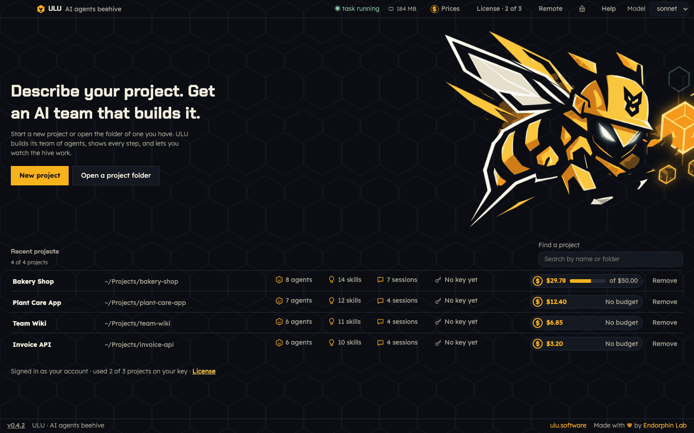

# Getting started

This guide takes you from install to your first finished task.



## 1. Install ULU

With Homebrew. This also installs git, the GitHub CLI, Node.js, Claude Code and Ollama:

```sh
brew install --cask endorphin-ai/tap/ulu
```

Or download `ULU-macos-universal.zip` from the [latest release](https://github.com/endorphin-ai/ulu-releases/releases/latest). Unzip it and move **ULU** to Applications.

ULU needs macOS 12 or later. It runs on Apple Silicon and Intel. It is signed and notarized by Apple.

Did you download the zip? ULU can still set up the tools for you. Below the list of projects, **Set up this computer** has one button that installs git, the GitHub CLI, Node.js, Claude Code and Ollama. The same part is also in a project's **Overview**.

## 2. Sign in to Claude Code

ULU works through Claude Code on your Mac. Open a terminal and run:

```sh
claude
```

Sign in once, then close the terminal. Every step in ULU that uses Claude spends your Claude usage.

To update Claude Code later, press **Update Claude Code** in **Set up this computer**. It runs `claude update` and shows any error.

## 3. Make a project

A project is a folder on your Mac.

- Press **New project** to start from an empty folder.
- Press **Open a project folder** to use a project that already has code.

Your projects show in **Recent projects**, with their bees, skills, sessions and cost.

## 4. Get a key

Your first project is free. In **License**, either:

- press **Sign in in the browser** and confirm the short code, or
- paste a key you got by email.

More projects need a paid key. See [Costs and budget](costs-and-budget.md).

## 5. Get a team

Open **Studio**. There are two ways:

- **A ready team.** Ten teams follow one proven flow: plan, design, build, review, test, security, deploy. They are: Elixir & Phoenix, Node & React, Next.js, FastAPI & React, Go & React, Django, Rails, Laravel, Flutter & Firebase, Expo & Supabase. Choose one in **Design**.
- **Your own team.** Write the **Brief** in your own words. Then tell Kukulu in **Design** what you want, and change the team until it is right.

Then open **Build**. ULU writes the team into your project. More in [Studio](studio.md).

## 6. Give the team a task

Open **Work → Hive**. On the right is **El Capitan**.

1. Write what you want as a result, not how to do it. For example: "Add a search box to the list of products."
2. Choose **Who does it**: the whole team, or only one bee.
3. Choose the permissions: **Ask me**, **Accept edits**, **Plan** or **Auto**.
4. Press **Start**.

Now watch the hive. More in [The Hive and El Capitan](the-hive-and-el-capitan.md).

## 7. Check the result

- **Session files** shows every file the bees wrote.
- **Git** shows the changes. Commit and push them, or open a pull request.
- **Test** runs your tests and shows the coverage.

## Tips

- Only one design answer, build, task or report runs at a time.
- Keep ULU open while a task runs.
- You can also start a task in Claude Code: run `/el-capitan Your task` in a terminal in the project folder. It shows in the hive too.
