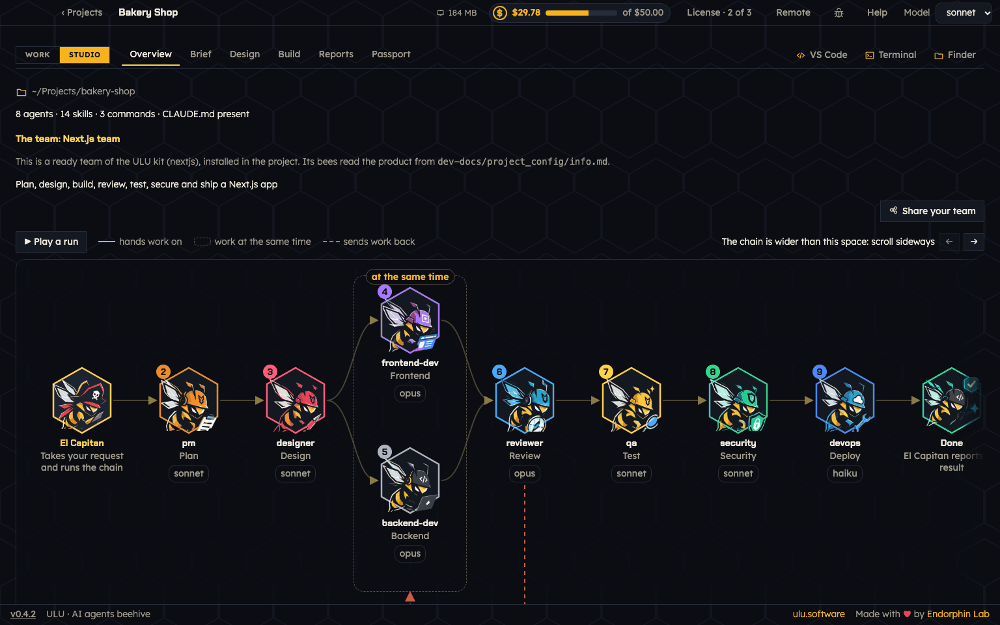

# Studio: brief, design and build your team

Open **Studio** at the top left. It has six tabs: **Overview**, **Brief**, **Design**, **Build**, **Reports** and **Passport**.

Studio goes one step at a time: Brief, Design, Build, then Work. While one step runs, the others wait. Each step says on top what it needs first.

## Overview

Overview shows your team as a **chain**: who works first, who works at the same time, and where work goes back to be fixed.

- A **gold arrow** hands the work on when the check of the step passes.
- A **dashed frame** holds bees that work at the same time.
- A **red dashed arrow** sends work back to be fixed when a check does not pass.

The number on a bee is its step. Click a bee to read what it gets, what it gives and what its check is. **Play a run** shows how the work moves. Below the chain is the list of agents, with their role, skill and model.

## Brief

Say what the project does and who uses it, in your own words. You do not need technical terms. ULU asks what kind of app it is: web, mobile, desktop or other.

For a project that already has code, ULU reads it first: its stack, scripts, tests and documents.

## Design

Choose a ready team here, or design your own with Kukulu. To change a team, just say it:

- "Add a tech lead who reviews the code and can send it back."
- "The backend and the frontend can work at the same time."
- "Use a cheaper model for the tester."

When the team is right, press **Approve the design**.

## Build

Build writes the team into your project: one file for each agent, its skills, and the command that runs the chain. It takes a few minutes. You see each step with its time and cost.

- A project with code starts with **Document the project**, so every skill is written for your project.
- After a change in Design, Build offers to build only what changed. A model or permission change applies in seconds.
- At the end ULU checks that every agent and skill is complete. If something is missing, ULU asks Claude to fix just those files. **Fix the problems** does it again when you want.
- **Stop the build** really stops. A team that worked stays as it was. A failed step offers **Resume from this step** and **Start again**.
- **Build history** lists every build, with its log.

When the build passes, press **Give the team a task**.

ULU writes the team's part of `CLAUDE.md` and `AGENTS.md`, and keeps everything else in them. The team keeps its work items in `dev-docs/`. Your own `docs/` folder is left to you.

## Reports

A report is a check of the team by Claude. Choose a kind and press Run. Start with the Audit. A report reads the project and changes nothing.

A finished report ends with numbered proposals. Tick the ones you want and press **Apply**. ULU copies the team to `.squad/backups` first. A change that fails is not put in place.

After a task, **Improve the team from this run** in the Hive does the same from what the bees did in that run.

## Passport

The Passport is the card of your project: its brief, its stack, its team, its repository and its numbers.
