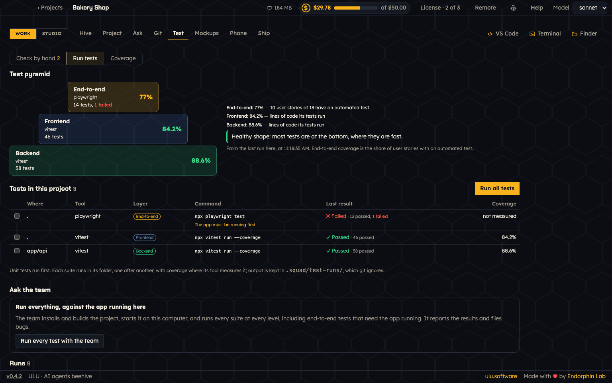

# Tests

Open **Work → Test**. It has three views: **Check by hand**, **Run tests** and **Coverage**.

## Run tests

ULU finds every test suite of your project, in every folder. It knows Playwright, Cypress, Vitest, Jest, Mocha, Ember, pytest, go test, mix test and many more.

**Tests in this project** lists each suite: where it is, its tool, its layer, its command, its last result and its coverage.

- **Run all tests** runs the suites one after another, with coverage where the tool measures it. Unit tests run first.
- Tick some suites to run only those.
- Some suites need the app to be running first, for example end-to-end tests. ULU says so next to the suite.
- Every run keeps its results and its output. Open **Output** to read it. Long lists show 20 at a time.

The output is kept in `.squad/test-runs/`, which git ignores.

## The test pyramid

The **Test pyramid** shows your tests in three layers:

- **End-to-end** on top: tests that use the app like a person does.
- **Frontend** in the middle.
- **Backend** at the bottom.

Each layer shows its tools, its number of tests, its failures and its coverage. For end-to-end, coverage means the share of user stories with an automated test. For the other layers, it is the share of lines of code the tests run.

A healthy pyramid has most tests at the bottom, where they are fast. ULU tells you when the pyramid is upside down.

## Ask the team

- **Run every test with the team**: the team installs and builds the project, starts it on this computer, and runs every suite at every level, end-to-end too. It reports the results and files bugs.
- **Scan the code and write stories**: for a project that already has code, the team writes the user stories and test cases of what it does today.

## Check by hand

Some things are best checked by a person. QA writes test cases with steps and what you should see. **Check by hand** lists them by user story.

1. Follow the steps in the app.
2. Write a note if you want: what you saw.
3. Press **Pass**, **Fail** or **Skip**.

When you fail a check, its card stays, the view switches to **Failed**, and **Write a bug** is right there. The bug goes to the team as its next work.

The bar on top shows how many checks passed, failed, were skipped or are not done yet.

## Coverage

**Coverage** puts it all together: stories, test cases, automated tests, checks by hand and code coverage.

- It shows which stories have tests, which tests failed, and test cases that test no story.
- **Least covered files** shows where tests are missing.
- A manual pass made on older code does not count as a current pass. That story shows as old, with **Recheck older results**.
- A finished task shows **View test results**, and coverage opens the exact run.
