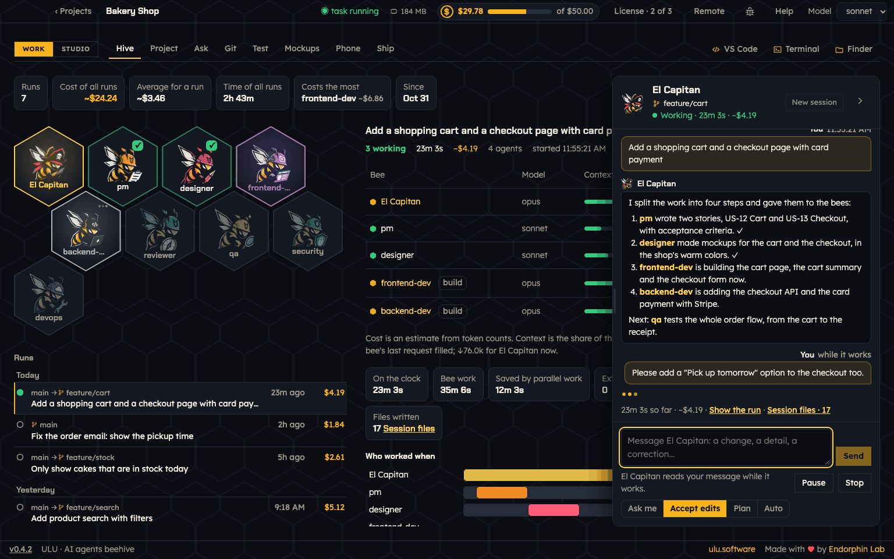
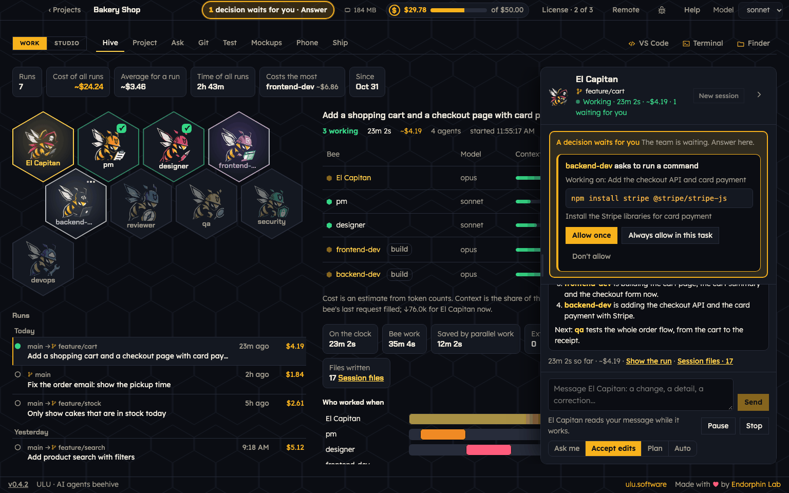
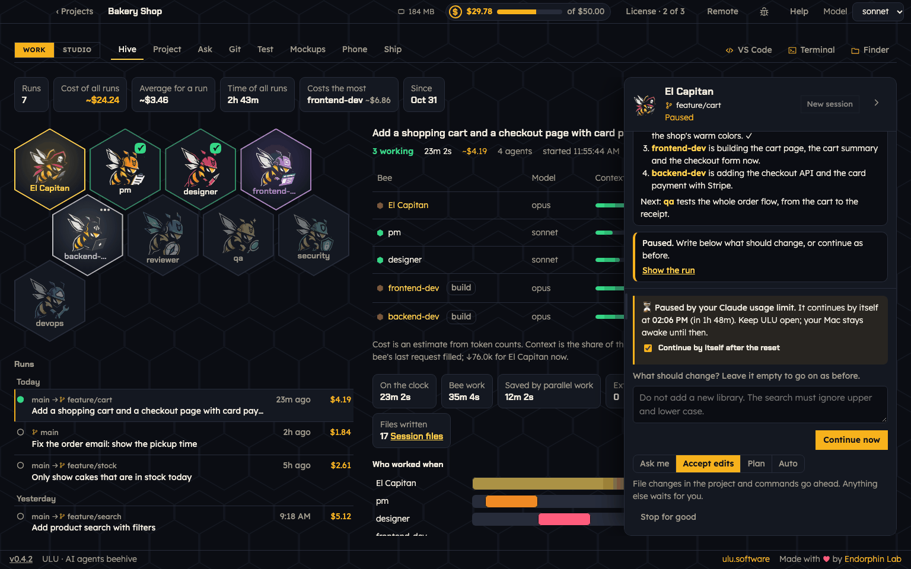
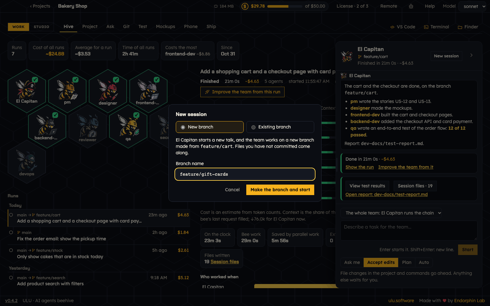

# The Hive and El Capitan

The **Hive** is where your team works. Open **Work → Hive**.

- On the left are the **bees** of your team, the list of **Runs**, and the numbers of all runs together.
- In the middle is the run you chose: each bee with its model, context, cost, time, tools and files.
- On the right is **El Capitan**, the leader of the team. You talk to the team here.

## Give the team a task

1. Write the task in El Capitan's box. Say what you want as a result, not how to do it.
   - "Build the to-do list: add a task, mark it done, delete it."
   - "The Delete button does nothing on the phone. Fix it."
2. Choose **Who does it**:
   - **The whole team**: El Capitan runs the whole chain. Every bee works in its order, and each step is checked.
   - **Only** one bee: good for a plan, a question, a review or a small fix. Nothing else checks the result.
3. Choose the permissions:
   - **Ask me**: every command and every file change waits for you to allow it.
   - **Accept edits**: file changes in the project and commands go ahead. Anything else waits for you.
   - **Plan**: the team reads and plans, and changes nothing. You approve the plan before any work.
   - **Auto**: Claude Code decides what is safe to do. What it is not sure of waits for you.
4. Press **Start**. Enter starts it too. Shift+Enter makes a new line.

You can also start a task in Claude Code: run `/el-capitan Your task` in a terminal in the project folder. It shows in the hive too.

## Watch the bees

Each bee shows its state: thinking, working or done.

- **Model**: the Claude model the bee uses.
- **Context**: how full the bee's memory is for this task. Above 85% the bee is tired, and its work can get worse.
- **Cost**, **Time**, **Tools**: what the bee used.
- **Files**: how many files it wrote. A green **+3** means three of them are new.

Click a bee to see what it was asked, which tools it used, which files it wrote and what it reported. **Who worked when** shows the bees on a timeline.

## Message El Capitan while it works

You do not need to pause the team to change something. Write a change, a detail or a correction in El Capitan's box and press **Send**. El Capitan takes it in at once and passes it on to the bees it concerns. Your message shows in the talk, marked "while it works".

## Answer the team's questions

Sometimes a bee needs your decision, for example to run a command. The question is pinned on top of El Capitan, above the talk. The top bar shows **1 decision waits for you · Answer** on every tab. Press it to go to the question.

- **Allow once**: the bee may do it this time.
- **Always allow in this task**: the bee may do it again in this task without asking.
- **Don't allow**: the bee may not. You can tell Claude why, or what to do instead.

In **Plan** mode you get the plan to read. Press **Approve the plan**, or **Keep planning** and say what should change.

You also get a notification on your Mac when the team needs you.

## Pause, continue and stop

- **Pause**: the work stops and can go on later. Write what should change, then press **Continue**. With nothing written, the team goes on as before. A paused task is kept when you close ULU.
- **Stop**: the task ends for good. Files the bees already wrote stay in the project. ULU asks before it stops.

## Usage limits: ULU waits and goes on by itself

When your Claude plan's limit is reached, the task is paused, not failed. El Capitan shows when the limit resets, with a countdown. The task goes on by itself a minute after the reset, in the same session, so the team remembers what it was doing.

- Keep ULU open. Your Mac stays awake until then.
- **Continue now** goes on sooner, for example after you added usage.
- Turn the auto-continue off for one task with **Continue by itself after the reset**, or for all tasks in **Help → Notifications**.
- You get a notification when the task pauses, and another when the team works again.

Monthly spend limits still stop a task, because they do not reset by waiting.

## Sessions and branches

A **session** is one talk with El Capitan. Each session works on a git branch. The branch shows on top of El Capitan.

Press **New session** on top of El Capitan:

- **New branch**: type a **Branch name** and press **Make the branch and start**. The branch is made from the one you are on. Files you have not committed come along.
- **Existing branch**: choose a branch you have, or one that is only on GitHub. To go to another branch, commit your changes first.

The next task of the team works on that branch. New session waits while the team works or a task is paused.

## Earlier runs

The **Runs** list on the left has every task, newest first, by day. Each run shows its branch, or where it went (for example `main → feature/cart`), when it ran and what it cost. Search finds runs by task, bee or branch.

Click a run and El Capitan shows its whole talk: what you asked and all El Capitan said. When that run was on another branch, one click switches to it. Press **Close** to go back to the current talk.

**Improve the team from this run** lets Claude read what the bees did and propose changes to the team. Nothing changes until you choose what to apply.

**Keep runs for** sets how long ULU keeps the history: 30 days, 90 days, 1 year or ever.

## When Claude Code refuses a tool call

A team often works without a person watching. When nobody can allow a tool call, Claude Code refuses it. ULU shows a notice, marks the bee with "refused", and lists in the run what was refused. If the team saves its reports in `.claude/reports`, which Claude Code always guards, the Hive offers **Move the reports out of .claude**.
